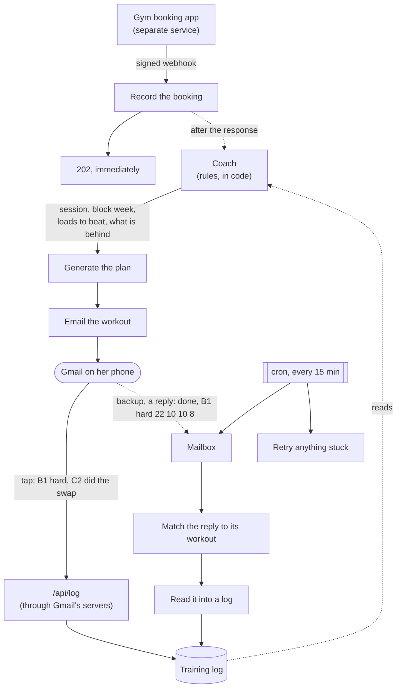

# Workout Loop

Booking a gym slot produces a workout by email. Tapping done, easy, hard or
skip under each exercise, inside the email, sets the weights for the next one.



Nothing in that loop needs a person, and no step blocks the one before it.

## The constraint that shapes everything

The phone this is read on **cannot open links**: not to a web page, not even a
jump to another part of the same email (tested on her phone). Gmail is the only
channel it has.

That is not a detail, it is the design:

- **The email is the entire product.** No dashboards, no "view in browser".
- **Logging is tapping inside the email.** Gmail's dynamic email (AMP for
  Email) runs forms inside the message and sends what she taps through
  Google's own servers, so nothing on the phone opens a link. Her Gmail allows
  dynamic email from the workout address (Settings, General, Dynamic email,
  Developer settings), which is what lets a personal sender use it. Tested on
  her phone before it was built on.
- **Three versions of every email.** The dynamic one she uses; plain HTML for
  any other client and for Gmail once a dynamic email is 30 days old, logged by
  replying; and plain text, exact and complete, wrapped to 50 characters.
- **Fewer words.** The exercises, their numbers, last time, the pictures while
  she is learning them, and the weekly bars. Nothing else.

## The training

Built for one person: a woman of 22 training for lean muscle and strength,
with her arms as her priority. The rules are in
[`lib/program.ts`](src/lib/program.ts), one file, each with its reason. The
plan she approved is [`docs/rebuild-plan.md`](docs/rebuild-plan.md), and the
research behind it is in [`docs/training-research.md`](docs/training-research.md),
[`docs/training-research-women-and-failure.md`](docs/training-research-women-and-failure.md),
[`docs/training-research-jumping.md`](docs/training-research-jumping.md) and
[`docs/training-research-four-day-split.md`](docs/training-research-four-day-split.md).
In short:

- **Four days, two muscle groups each, in order.** Back + biceps, glutes +
  hamstrings (with an ab finisher), chest + triceps, quads + glutes. Sessions
  come in order, not by weekday, and every other week one of them is full body
  instead. Her classes (HIIT, tabata, a strength class) are her own; she can
  mention one in the comment box and the next session eases off.
- **Heavy main lifts, twice a week each.** Squat, deadlift, bench and a heavy
  pull: 4 to 5 sets of 3 to 5 on their day, 2 to 3 sets of 6 to 8 on another.
  Strength grows most with heavy weights; muscle grows about the same at any
  weight as long as the sets are hard.
- **Arms first.** Two biceps exercises on the back day, two triceps on the
  chest day: 12 to 16 sets a week each. Glutes get a normal share.
- **Stop short on heavy lifts, failure only where it is cheap.** 2 to 3 reps
  short on squats and deadlifts, 1 to 2 on presses and pulls; small exercises
  may take their last set to failure. The coach rations failure whatever the
  model writes.
- **Main lifts stay, the rest rotates.** Main lifts are kept from block to
  block so strength can be seen going up; everything else changes each
  five-week block, the fifth week lighter.
- **One swap per exercise**, opening in place, for when a machine is taken.
  Skipped twice in a row, and the swap takes over.
- **Never** anything braced on a chest pad, or a medicine ball chest pass. The
  coach removes them whatever the model writes.
- **Jumps once a week, in the warm up.** Jumping suits her stage; at once a
  week it is power and landing practice, kept short.
- **Not programmed by cycle phase.** How she says she feels adjusts a session.

## How it is put together

**The coach decides; the model writes.** Everything that can be decided by
rule is decided in code before the model is called: which session in the
rotation today is, which week of which block, whether it is a lighter week,
which muscles are behind this week, and exactly what every lift she has done
before should be next: its weight and its rep target. The model gets those as
facts and chooses the movements and their swaps. If it drifts from a number the
coach set, the coach's number is put back.

**The plan is data, and the code does the layout.** The model returns a
structured plan (blocks, exercises, labels, loads, muscles worked) rather than
text to be parsed back apart, so the email is the same shape every time and
every exercise carries what the tracking needs.

**Progress is measured from what she logged, and nothing is assumed.** Each
lift has an exact rep target inside its range. Done means the sets as written,
and the target goes up a rep; at the top of the range the weight goes up a step
and the reps go back to the bottom. Easy puts the weight up now. Hard keeps it;
hard twice in a row brings it down a step. Skipped, or not logged, keeps it.
Numbers she types ("20kg 10 10 8") are what she did. The last tap counts, undo
clears, and "all done" marks everything not tapped. Two workouts in a row with
nothing logged, and the next email asks about them at the top, with one tap
each. Progress started fresh with this method: older workouts are history only.

The interesting logic is pure and tested without a database, a mailbox or an
API key.

| Module | Does | Pure |
|---|---|---|
| `lib/program.ts` | The training rules, as data | yes |
| `lib/coach.ts` | Rotation, blocks, volume, targets, swaps, what the model may not change | yes |
| `lib/progress.ts` | Counts: sets per muscle, bests, stalls, exposures, what is unlogged | yes |
| `lib/plan.ts` | The plan's shape, its schema, checking what came back, the bans | yes |
| `lib/prompt.ts` | The philosophy and the coach's brief, as a prompt | yes |
| `lib/taps.ts` | Logging by tapping, and taps as the log a reply makes | yes |
| `lib/reply-log.ts` | A reply as data, and a reader for the shorthand | yes |
| `lib/summary.ts` | The weekly bars | yes |
| `lib/workout-mail.ts` | The workout email: plain HTML and text | yes |
| `lib/workout-amp.ts` | The workout email: the dynamic version she taps in | yes |
| `lib/amp-cors.ts` | The sender check Gmail makes before showing a tap's answer | yes |
| `lib/reminders.ts` | Which unlogged workouts to ask about; the app's address | yes |
| `lib/exercise-name.ts` | Decides when two exercise names mean the same movement | yes |
| `lib/exercise-pictures.ts` | Picks the drawing, or the photo, for each exercise | yes |
| `lib/reply-parse.ts` | Strips quoted text, reads the threading headers | yes |
| `lib/reply-match.ts` | Decides which workout a reply answers | yes |
| `lib/booking-payload.ts` | Validates what the gym app sends | yes |
| `lib/signature.ts` | HMAC over the webhook body | yes |
| `lib/workout-shape.ts` | Reads workouts from before plans were structured | yes |
| `lib/claude.ts` | The one call to Claude, JSON in a schema | no |
| `lib/generate.ts` | A plan from a brief, or a stand in | no |
| `lib/reply-read.ts` | A reply read into a log: shorthand first, Claude if needed | no |
| `lib/delivery.ts` | Booked to sent, shared by the webhook and the retry | no |
| `lib/replies.ts` | Polls, matches, files, then reads | no |
| `lib/workouts.ts`, `lib/preferences.ts` | The training log and preferences, from the database | no |
| `lib/mail-out.ts`, `lib/mail-in.ts`, `lib/mailbox.ts` | SMTP and IMAP, one account | no |
| `lib/picture-library.ts` | The vendored drawings and photos on disk | no |
| `app/api/log` | Files a tap; answers what is logged so far | no |
| `app/pictures/[source]/[file]` | Serves the pictures to the dynamic email | no |

**Pictures on a tap.** Under each exercise, "How to" opens the line drawing
(Everkinetic, CC BY-SA 4.0, credited in the email), two frames small and
side by side, loaded from this app over https through Gmail's image
servers. Without a drawing it opens on two plain sentences. Photos were tried
and dropped: on her phone they were too small to see. The plain version
carries no pictures, only the two sentences while she is learning a movement.

A few decisions worth knowing:

**Filing a reply and reading it are two steps.** Filing is a database write
that cannot fail for any interesting reason; reading calls a model that can. A
reply is filed first, and the cron retries reading it until it works or gives
up, at which point it still feeds the next session as prose.

**Taps are checked twice.** Each email's buttons carry a random secret for
that workout, so a tap can only ever be filed against the workout it came from,
and Gmail names the sender of the email it came from, which must be the
workout address. The dynamic email is checked against the AMP for Email rules
in the tests, because Gmail silently shows the plain version instead of one
that breaks any of them.

**Generation happens after the response, not during it.** It takes about thirty
seconds. Booking a gym slot must not wait on that, so the webhook records the
booking, answers `202`, and generates in `after()`. If that work is ever killed
the row stays `pending` and the cron picks it up.

**A retry is not a second code path.** `deliverWorkout` is the same function the
webhook calls, run again. Each step records what it achieved first, so a workout
that generated but failed to send is never generated twice.

**Replies match on the whole thread.** `In-Reply-To` names only the message
immediately before, which is not always the workout. `References` carries the
whole chain. The subject line is the last resort, and an ambiguous subject
matches nothing rather than the likeliest candidate: feedback filed against the
wrong session silently steers the next one.

**Idempotency is in the schema, not in code.** `workouts.booking_ref`,
`feedback.source_message_id` and `workouts.log_token` are unique, so a webhook
delivered twice inserts once and a message seen twice files once. Nothing has
to remember to check.

## Running it

```bash
npm install
npm test
npm run dev
```

**It runs with nothing configured.** Without an API key the generator returns a
canned plan; without a mailbox, mail prints to the console and the poller does
nothing. The whole loop is exercisable on a laptop with an empty `.env`, which
is the reason it was buildable before any account existed.

**A workout without a booking.** The "Send a workout now" action in the
repository's Actions tab records a session starting now and sends its workout
through the same path a booking takes, so it counts in the history and a reply
to it is matched like any other. It can ask for a focus (upper means no legs:
the coach strips any leg exercise from the plan, whatever the model writes)
and carry a note in her own words. It calls `/api/workout` with the cron's
secret.

```bash
npm run generate:once      # print a workout, with diagnostics
npm run send:once          # generate one and send it
npm run workout            # record a session and send it, for real
npm run tick               # one turn of the cron by hand
npm run db:migrate         # apply migrations
npm run vendor:pictures    # rebuild assets/exercise-pictures
npm run vendor:drawings    # rebuild assets/exercise-drawings
```

**The pictures are vendored, not fetched.** `assets/exercise-drawings` holds
268 exercises from [Everkinetic](https://github.com/everkinetic/data) (CC BY-SA
4.0) as PNG, about 5MB, matched only by exact name or a name checked by hand.
`assets/exercise-pictures` holds 873 photos from
[free-exercise-db](https://github.com/yuhonas/free-exercise-db) (public domain),
about 25MB, matched by words for what the drawings miss. `next.config.ts` names
both directories so the Vercel functions ship with them.

## Configuring it

Copy `.env.example` to `.env`. Nothing in it is required to run; each missing
value degrades to a safe stand in.

| Variable | Without it |
|---|---|
| `DATABASE_URL` | Nothing works. The only hard requirement. |
| `ANTHROPIC_API_KEY` | A canned plan instead of a generated one |
| `MAILBOX_ADDRESS`, `MAILBOX_PASSWORD` | Mail prints to the console, replies are not polled |
| `OWNER_EMAIL` | Nowhere to send, and no address whose replies count |
| `BOOKING_WEBHOOK_SECRET` | Open in development, refused in production |
| `CRON_SECRET` | Open in development, refused in production |
| `BASIC_AUTH_USER`, `BASIC_AUTH_PASSWORD` | Preferences page open in development, refused in production |
| `APP_URL` | Vercel's production address is used; without either, no dynamic version |

One mailbox does both directions. A reply goes back to whoever sent the workout,
so sending and reading have to be the same account for a reply to be findable at
all. For Gmail the password is an App Password, which needs 2FA on that account.

## Deploying

Vercel plus Neon, both on free tiers. The scheduler is GitHub Actions rather
than Vercel Cron, because the free Vercel tier limits cron frequency and Actions
on a public repository does not.

Vercel runs `vercel-build`, which applies any pending migrations before
building, so a deployment never goes live against a schema it does not match.
Migrations so far only ever add columns and tables.

Repository secrets needed by `.github/workflows/cron.yml`:

- `APP_URL`, the deployed origin with no trailing slash
- `CRON_SECRET`, matching the deployment

## Cost

About a dollar a month at four sessions a week. Generation is roughly six to
eight cents a workout on Claude Opus 5.5. Logging costs nothing: taps and typed
numbers are read in code, and her words go to the model inside the request
that already writes the next workout. A reply in the short form is read in
code too; only a free-form reply goes to the model, for a cent or two. Hosting,
the database, mail and the scheduler are all inside free tiers.

Prompt caching is deliberately unused: output is about 80% of every call, so
caching the stable parts would save well under a cent per workout in exchange
for real complexity.

## Tests

```bash
npm test
```

Node's own runner, no framework. The heaviest coverage is where a mistake
would be silent: the coach (a wrong target is a number she trusts and lifts),
the dynamic email's AMP rules (a broken one silently falls back to the plain
version), and quoted text stripping (an unstripped reply files the whole
previous workout as something she said).
