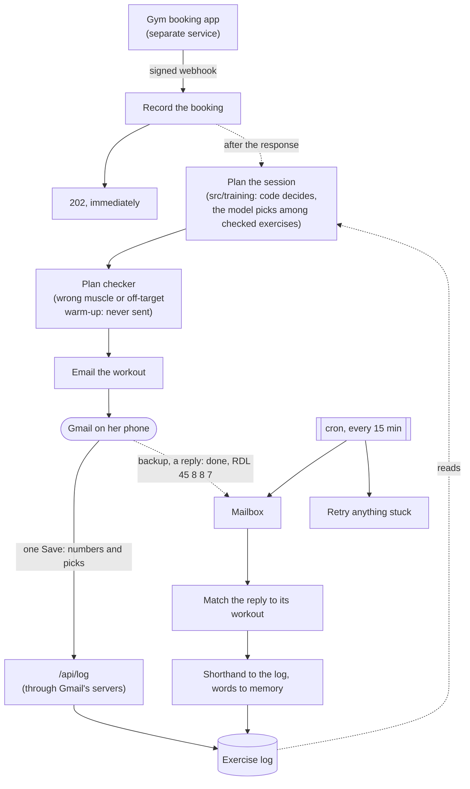

# Workout Loop

Booking a gym slot produces a workout by email. She sets the numbers on each
exercise to what she did, skips what she didn't, and presses Save inside the
email. Every tap is kept as she goes, so closing Gmail loses nothing. That
sets the next workout.



Nothing in that loop needs a person, and no step blocks the one before it.

The design she agreed is
[`docs/superpowers/specs/2026-11-13-workout-loop-v2-design.md`](docs/superpowers/specs/2026-11-13-workout-loop-v2-design.md),
and the evidence behind the training is
[`docs/research/2026-11-progressive-overload.md`](docs/research/2026-11-progressive-overload.md).

## The constraint that shapes everything

The phone this is read on **cannot open links**. Gmail is the only channel it
has, so **the email is the entire product**. Logging happens inside the email:
Gmail's dynamic email (AMP for Email) runs forms in the message and sends them
through Google's servers. Her Gmail allows dynamic email from the workout
address. Every email has three versions:

- the dynamic one she uses;
- plain HTML, for other clients and for Gmail once a dynamic email is 30 days
  old, logged by replying;
- plain text wrapped to 50 characters.

The one web page, **Your gym**, is for a computer.

## The training

Built for one person: a woman in her early twenties training for lean muscle
and strength, balanced, with arms a little ahead. Every number is in
[`src/training/rules.ts`](src/training/rules.ts), each with its reason and its
confidence from the research.

**The week.** Four focused days in order, not by weekday, so a missed day
shifts the rest:

1. back + biceps;
2. glutes + hamstrings, then abs;
3. chest + triceps, with a little shoulder work;
4. quads + glutes, then abs.

Every other week, full body replaces the quads + glutes day. Each muscle gets
about 10 hard sets a week (arms 12 to 13), all on its day.

**Progression.** Double progression. Reps go up to the top of the range, then
the weight goes up a step that exists at her gym (her plates are 10, 7.5 and
5 kg, so a jump of more than 10% earns more reps first). The numbers she sets
are the effort check: she sets them to what was just right. A stall drops the weight and rebuilds it; a second stall swaps the
exercise. A first-time exercise starts light and she finds the weight.
Lighter weeks happen only when she is struggling, never on a schedule.

**Exercises.** 135 exercises reviewed by hand (`assets/exercises/overrides.json`).
The 78 with an exact Everkinetic drawing are the ones that can be chosen,
because the drawing, behind a small arrow by the name, is the only how-to. Big lifts stay for a long time; small
exercises rotate every five weeks, or straight away when she complains.

**Her words.** Comments and replies become notes (`src/memory`): wrong muscle,
pain, too hard, too easy, dislike, one-off or liked. Only dislike is a hard
rule. A change made because of a note shows in the next email with an undo.

## How it is put together

**Code decides; the model picks.** Code builds the session's slots: which
muscle, what kind of exercise, how many sets. It filters the candidates for
each slot and sets every number. The model only chooses among those
candidates. A checker then refuses a plan in which any exercise or swap does
not train its slot's muscle, or a warm-up move is for a muscle the session
does not train. It sends the reasons back twice, then code fills the slot
itself. A plan that fails is never emailed. The warm-up is built from the
plan, never written on its own.

| Module | Does | Pure |
|---|---|---|
| `training/rules.ts` | Every training number, with its reason | yes |
| `training/equipment.ts` | Weights that exist at her gym | yes |
| `training/catalogue.ts` | The reviewed exercises | yes |
| `training/skeleton.ts` | Which day it is, its slots and sets | yes |
| `training/candidates.ts` | Whether a slot may change, and what may fill it | yes |
| `training/check.ts` | The plan checker | yes |
| `training/progress.ts` | Double progression from what she logged | yes |
| `training/warmup.ts` | The warm-up, from the plan | yes |
| `training/deload.ts` | Lighter weeks when needed, and volume growth | yes |
| `training/build.ts` | History to a checked plan | yes, given a picker |
| `training/choose.ts` | The model picks among candidates | no |
| `training/history.ts` | The log, notes and equipment in the database | no |
| `memory/read.ts`, `memory/apply.ts` | Her words to notes, and what notes do | read: no; apply: yes |
| `email/cards.ts`, `amp.ts`, `html.ts`, `text.ts` | The workout email, three versions | yes |
| `email/reply.ts` | Reply shorthand into the log | yes |
| `email/checkin.ts`, `lib/checkin.ts` | The monthly check-in | email: yes |
| `lib/v2.ts` | Planning, the email, logging and reading, wired together | no |
| `lib/delivery.ts`, `lib/cron.ts` | Booked to sent, with retries | no |
| `lib/replies.ts`, `reply-parse.ts`, `reply-match.ts` | Polls, matches and files replies | match/parse: yes |
| `lib/mail-out.ts`, `mail-in.ts`, `mailbox.ts` | SMTP and IMAP, one account | no |
| `lib/amp-cors.ts` | The sender check Gmail makes before showing an answer | yes |
| `lib/booking-payload.ts`, `signature.ts` | The booking webhook's checks | yes |

A few decisions worth knowing:

**Filing a reply and reading it are two steps.** Filing is a database write;
reading may call a model. A reply is filed first, and the cron retries reading
it.

**What she taps is kept as she goes.** Gmail forgets a dynamic email's state
when the app closes, and an email cannot load state by itself (`amp-state` is
inline only). So every tap also posts the whole email's state to the
workout's draft, and when she comes back, "Pick up where you left off" at the
top asks for it and sets it in one go (`email/draft.ts`). Only Save logs.

**The Save is checked twice.** Each email's form carries a random secret for
that workout, and Gmail names the sender of the email, which must be the
workout address. The dynamic email is tested against the AMP for Email rules,
because Gmail silently shows the plain version instead of one that breaks any.

**Generation happens after the response.** The webhook records the booking,
answers `202`, and plans in `after()`. If that is ever killed, the row stays
`pending` and the cron picks it up. A retry is the same function run again,
and the plan is stored before sending, so a retry sends the same workout.

**Idempotency is in the schema.** `workouts.booking_ref`,
`feedback.source_message_id`, `workouts.log_token` and
`exercise_log (workout, slot)` are unique.

## Running it

```bash
npm install
npm test
npm run dev
```

**It runs with nothing configured.** Without an API key, code picks every
exercise. Without a mailbox, mail prints to the console and the poller does
nothing.

**A workout without a booking.** "Send a workout now" in the Actions tab
records a session starting now and sends it through the same path a booking
takes. It can ask for upper, lower or full body. "Preview the workout email"
sends a sample marked Preview, which never counts as training.

```bash
npm run preview:email      # render sample emails to files, no database
npm run e2e:v2             # booking to Save to reply, against a scratch database
npm run workout            # record a session and send it, for real
npm run tick               # one turn of the cron by hand
npm run db:migrate         # apply migrations
npm run vendor:catalogue   # refresh assets/exercises/raw.json
npm run vendor:drawings    # rebuild assets/exercise-drawings
```

**The drawings are vendored.** `assets/exercise-drawings` holds 268 drawings
from [Everkinetic](https://github.com/everkinetic/data) (CC BY-SA 4.0). Each
reviewed exercise names its exact drawing in `overrides.json`, and a test
checks that every choosable exercise has one that exists.

## Configuring it

Copy `.env.example` to `.env`. Each missing value degrades to a safe stand-in.

| Variable | Without it |
|---|---|
| `DATABASE_URL` | Nothing works. The only hard requirement. |
| `ANTHROPIC_API_KEY` | Code picks every exercise; comments are read by keywords |
| `MAILBOX_ADDRESS`, `MAILBOX_PASSWORD` | Mail prints to the console, replies are not polled |
| `OWNER_EMAIL` | Nowhere to send, and no address whose replies count |
| `BOOKING_WEBHOOK_SECRET` | Open in development, refused in production |
| `CRON_SECRET` | Open in development, refused in production |
| `BASIC_AUTH_USER`, `BASIC_AUTH_PASSWORD` | The gym page is open in development, refused in production |
| `APP_URL` | Vercel's production address is used; without either, no dynamic version |

One mailbox does both directions, so a reply goes back to the account that
reads replies. For Gmail the password is an App Password, which needs 2FA.

## Deploying

Vercel plus Neon, both on free tiers. The scheduler is GitHub Actions, whose
cron on a public repository is free. `vercel-build` applies pending migrations
before building. Migrations only ever add columns and tables, so the old app's
data is still in the database, unused.

Repository secrets for the workflows: `APP_URL` (the deployed origin) and
`CRON_SECRET`.

## Tests

```bash
npm test
```

Node's own runner. The heaviest coverage is where a mistake would be silent:

- the plan checker, run on 200 random histories with deliberately bad model answers;
- the anatomy rules every exercise must keep;
- progression;
- the dynamic email's AMP rules;
- quoted-text stripping in replies.
