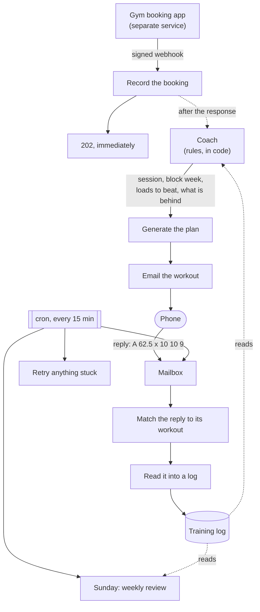

# Workout Loop

Booking a gym slot produces a workout by email. Replying to that email with
what was lifted sets the weights for the next one.



Nothing in that loop needs a person, and no step blocks the one before it.

## The constraint that shapes everything

The phone this is read on **has no web browser**. Email is the only channel it
has.

That is not a detail, it is the design:

- **There is nothing to click.** No links, no dashboards, no "view in browser".
  The email is the entire product.
- **Feedback is a reply**, because a reply is the only interaction email
  supports without a browser.
- **Both message bodies are real.** The HTML one is what the mail client
  renders, so colour separates what is scanned for mid set. The plain text one
  is exact and complete, because it is what any client without HTML falls back
  to.
- **Lines are capped at 50 characters.** A note that wraps on a narrow screen
  turns a two line exercise into four and destroys the layout.

## The training

Built for one person: a woman in her early twenties training for lean muscle,
health and the long run. The rules are in [`lib/program.ts`](src/lib/program.ts),
one file, each with its reason, and the research behind them is in
[`docs/training-research.md`](docs/training-research.md) and its follow-up on
sex differences and training to failure,
[`docs/training-research-women-and-failure.md`](docs/training-research-women-and-failure.md).
In short:

- **Muscle comes from hard sets, progressed.** About 12 to 20 hard sets per
  muscle a week, each muscle at least twice, a lighter week every fifth.
- **Built for a young woman, not a scaled-down man.** Women grow muscle by the
  same mechanisms and at about the same percentage rate as men, but from a
  smaller start (about 40% less upper body muscle) and they hold their reps
  better from set to set. So the upper body gets full volume, rests sit at the
  short end of normal, and loads are pushed rather than played safe, because
  lifting lighter than she can is the commonest mistake.
- **Close to failure, and failure where it is cheap.** Heavy barbell lifts
  stop a rep or two short and never fail on purpose. Machine and isolation
  work takes its last set to failure. Light, high rep sets only count when
  taken there. The coach rations failure whatever the model writes.
- **Lift heavy for bone, and jump only when she chooses.** Her early
  twenties are the last years with bone still to build, and every session has
  a heavy anchor lift. Jumping is a setting, jump days per week (default one):
  on a jump day the primer is a short block of jumps; on every other day the
  coach strips any jump, hop, bound, skip or burpee from the plan whatever the
  model writes, and the primer is throws and swings instead.
- **A little hard conditioning for the heart.** Short finishers on a bike,
  rower, sled or kettlebell, 8 to 20 hard minutes a week, kept after the lifting
  so they cost no muscle.
- **Fun that is capped.** Primers, supersets, EMOMs, complexes, carries and
  flows make it feel athletic. The muscle work keeps most of the time anyway.
- **Not programmed by cycle phase.** The best recent trials find no advantage
  to it. How she says she feels is what adjusts a session, and every email says
  what to do if today feels off.

## How it is put together

**The coach decides; the model writes.** Everything that can be decided by
rule is decided in code before the model is called: which session in the
rotation today is, which week of which block, whether it is a lighter week,
which muscles are behind this week, how many hard minutes the week still wants, and
exactly what every lift she has done before should weigh next. The model gets
those as facts and does what it is good at: choosing movements, making the
session feel like a session, and explaining each exercise. If it drifts from a
load the coach set, the coach's number is put back.

**The plan is data, and the code does the layout.** The model returns a
structured plan (blocks, exercises, labels, loads, muscles worked) rather than
text to be parsed back apart, so the email is the same shape every time and
every exercise carries what the tracking needs.

**Progress is measured from what she did, not what was asked.** A reply like
`A 62.5 x 10 10 9` or "hip thrusts were 70 all the way, last set only 7" is read
into a log. Loads progress by double progression from those numbers: all sets
at the top of the range earns the next step, short of it means beat the reps,
a grind means drop. With no reply, the prescription stands in, and the email
says so. What was read is shown at the top of the next workout so a misreading
can be corrected by replying again.

The interesting logic is pure and tested without a database, a mailbox or an
API key.

| Module | Does | Pure |
|---|---|---|
| `lib/program.ts` | The training rules, as data | yes |
| `lib/coach.ts` | Rotation, blocks, volume, load targets, finisher choice | yes |
| `lib/progress.ts` | Counts: sets per muscle, hard sets, bests, trends, stalls | yes |
| `lib/plan.ts` | The plan's shape, its schema, and checking what came back | yes |
| `lib/prompt.ts` | The philosophy and the coach's brief, as a prompt | yes |
| `lib/reply-log.ts` | A reply as data, and a reader for the shorthand | yes |
| `lib/summary.ts` | What is worth saying about the counts | yes |
| `lib/workout-mail.ts` | What the workout email says and looks like | yes |
| `lib/review.ts` | What the weekly review says and looks like | yes |
| `lib/exercise-name.ts` | Decides when two exercise names mean the same movement | yes |
| `lib/exercise-pictures.ts` | Picks which stills go with a plan | yes |
| `lib/reply-parse.ts` | Strips quoted text, reads the threading headers | yes |
| `lib/reply-match.ts` | Decides which workout a reply answers | yes |
| `lib/booking-payload.ts` | Validates what the gym app sends | yes |
| `lib/signature.ts` | HMAC over the webhook body | yes |
| `lib/workout-shape.ts` | Reads workouts from before plans were structured | yes |
| `lib/claude.ts` | The one call to Claude, JSON in a schema | no |
| `lib/generate.ts` | A plan from a brief, or a stand in | no |
| `lib/reply-read.ts` | A reply read into a log by Claude, or the shorthand reader | no |
| `lib/delivery.ts` | Booked to sent, shared by the webhook and the retry | no |
| `lib/replies.ts` | Polls, matches, files, then reads | no |
| `lib/weekly.ts` | Sends the Sunday review, once | no |
| `lib/workouts.ts`, `lib/preferences.ts` | The training log and preferences, from the database | no |
| `lib/mail-out.ts`, `lib/mail-in.ts`, `lib/mailbox.ts` | SMTP and IMAP, one account | no |
| `lib/picture-library.ts` | The vendored stills on disk | no |

**The pictures are in the body, not attached.** Two stills per exercise, the
start and the end of the movement, directly under the exercise they belong to
and referred to by `cid:`. Attached instead, they would arrive as a row of
files at the bottom of the message in whatever order they went in, which
answers "what does this look like" with "scroll down and guess". A movement
with no picture says so, because a silent gap reads as an email that failed to
load and there is no browser here to go and check.

A few decisions worth knowing:

**Filing a reply and reading it are two steps.** Filing is a database write
that cannot fail for any interesting reason; reading calls a model that can. A
reply is filed first, and the cron retries reading it until it works or gives
up, at which point it still feeds the next session as prose.

**The weekly review is counted, not written.** Sunday morning, one short email:
sessions, hard sets per muscle against target, hard minutes, new bests,
how the lifts have moved this block, what is stuck, and what next week is. No
model writes it, so it costs nothing and is never wrong about a number. A week
with no training gets no email.

**Generation happens after the response, not during it.** It takes about thirty
seconds. Booking a gym slot must not wait on that, so the webhook records the
booking, answers `202`, and generates in `after()`. If that work is ever killed
the row stays `pending` and the cron picks it up.

**A retry is not a second code path.** `deliverWorkout` is the same function the
webhook calls, run again. Each step records what it achieved first, so a workout
that generated but failed to send is never generated twice.

**Replies match on the whole thread.** `In-Reply-To` names only the message
immediately before, which is not always the workout. `References` carries the
whole chain. The subject line is the last resort, and an ambiguous subject
matches nothing rather than the likeliest candidate: feedback filed against the
wrong session silently steers the next one.

**Idempotency is in the schema, not in code.** `workouts.booking_ref`,
`feedback.source_message_id` and `reviews.week_of` are unique, so a webhook
delivered twice inserts once, a message seen twice files once, and a cron that
runs every fifteen minutes sends each week's review once. Nothing has to
remember to check.

## Running it

```bash
npm install
npm test
npm run dev
```

**It runs with nothing configured.** Without an API key the generator returns a
canned plan; without a mailbox, mail prints to the console and the poller does
nothing. The whole loop is exercisable on a laptop with an empty `.env`, which
is the reason it was buildable before any account existed.

```bash
npm run generate:once      # print a workout, with diagnostics
npm run send:once          # generate one and send it
npm run workout            # record a session and send it, for real
npm run tick               # one turn of the cron by hand
npm run db:migrate         # apply migrations
npm run vendor:pictures    # rebuild assets/exercise-pictures
```

**The pictures are vendored, not fetched.** `assets/exercise-pictures` holds
873 exercises from [free-exercise-db](https://github.com/yuhonas/free-exercise-db)
(public domain), shrunk to the width an email needs: about 25MB in the
repository, and nothing to call while a workout is going out. Matching a
prescribed exercise to one of them is fuzzy, because the model writes "SMITH
OVERHEAD PRESS" for what the catalogue calls "Smith Machine Overhead Shoulder
Press". `next.config.ts` names the directory so a Vercel function ships with
it; the files are read by name, so nothing in the build graph points at them.

## Configuring it

Copy `.env.example` to `.env`. Nothing in it is required to run; each missing
value degrades to a safe stand in.

| Variable | Without it |
|---|---|
| `DATABASE_URL` | Nothing works. The only hard requirement. |
| `ANTHROPIC_API_KEY` | A canned plan instead of a generated one |
| `MAILBOX_ADDRESS`, `MAILBOX_PASSWORD` | Mail prints to the console, replies are not polled |
| `OWNER_EMAIL` | Nowhere to send, and no address whose replies count |
| `BOOKING_WEBHOOK_SECRET` | Open in development, refused in production |
| `CRON_SECRET` | Open in development, refused in production |
| `BASIC_AUTH_USER`, `BASIC_AUTH_PASSWORD` | Preferences page open in development, refused in production |

One mailbox does both directions. A reply goes back to whoever sent the workout,
so sending and reading have to be the same account for a reply to be findable at
all. For Gmail the password is an App Password, which needs 2FA on that account.

## Deploying

Vercel plus Neon, both on free tiers. The scheduler is GitHub Actions rather
than Vercel Cron, because the free Vercel tier limits cron frequency and Actions
on a public repository does not.

Vercel runs `vercel-build`, which applies any pending migrations before
building, so a deployment never goes live against a schema it does not match.
Migrations so far only ever add columns and tables.

Repository secrets needed by `.github/workflows/cron.yml`:

- `APP_URL`, the deployed origin with no trailing slash
- `CRON_SECRET`, matching the deployment

## Cost

About a dollar a month at three sessions a week. Generation is roughly six to
eight cents a workout on Claude Opus 5.5; reading a reply is a cent or two at
low effort, and a reply in the shorthand would read fine without a model at
all. The weekly review is counted in code and costs nothing. Hosting, the
database, mail and the scheduler are all inside free tiers.

Prompt caching is deliberately unused: output is about 80% of every call, so
caching the stable parts would save well under a cent per workout in exchange
for real complexity.

## Tests

```bash
npm test
```

Node's own runner, no framework. The heaviest coverage is where a mistake
would be silent: quoted text stripping (an unstripped reply files the whole
previous workout as something she said), and the coach (a wrong load target is
a number she trusts and lifts).
